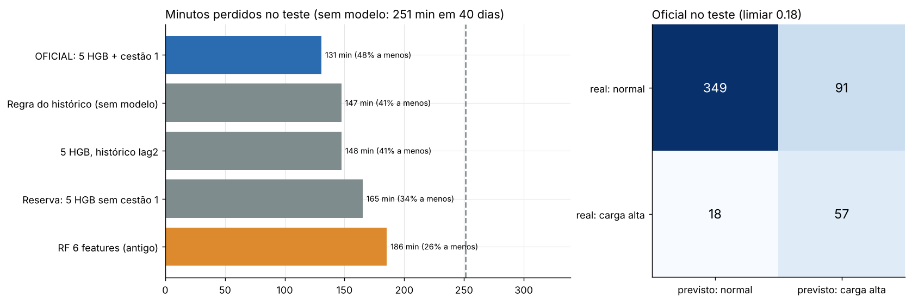

# Previsão de carga alta no forno elétrico a arco

Projeto final do bootcamp de Ciência de Dados do Fundo Amanhã, feito com dados reais da **EVCOMX**.

## Equipe

| | |
|---|---|
| Geórgia Muniz | Ciência da Computação |
| Lucas Talamini | Estatística |
| Mateus Schenato | Ciência da Computação |
| Teresa Bauer | Engenharia Elétrica |

**Professor:** Fabrício Leal (Fundo Amanhã, Diretor Executivo e Vice-presidente)

---

## O problema

Numa aciaria, a sucata entra no forno elétrico a arco (FEA) em cestões, montados em camadas de material leve, misto e pesado. Às vezes o cestão fica "alto" demais e o forno precisa parar para acomodar a carga. A pergunta do projeto:

> Antes de despejar o cestão, dá para saber se ele vai dar carga alta?

É um problema de classificação (sim ou não), com uma classe rara: só cerca de **15 a 18% dos cestões** têm carga alta.

**O critério de negócio vem da EVCOMX:** o melhor modelo é o que faz **perder menos minutos de forno**. Uma carga alta não detectada custa a duração da parada (~4 min em média); um alarme falso custa 1 min, o tempo de reajustar a montagem.

<p align="center">
  
</p>
<p align="center"><sub>No teste (24/jun a 4/ago/2026), sem modelo o forno perdeu 251 min. Com o modelo oficial, 131 min (48% a menos).</sub></p>

---

## O modelo oficial

**Média das probabilidades de 5 Gradient Boosting** (`HistGradientBoostingClassifier` com hiperparâmetros levemente diferentes, sem pesos de classe), com **121 features**: as 84 da receita do cestão, 36 de histórico do forno, gusa líquida, ritmo e regime recente, e o **resultado do cestão 1**. A EVCOMX confirmou que esse resultado é conhecido quando o cestão 2 ainda pode ser mexido.

| No teste (515 cestões, 75 cargas altas, 40 dias) | PR-AUC | Minutos perdidos | Economia |
|---|---|---|---|
| **Modelo oficial: 5 Gradient Boosting + cestão 1** | **0,567** | **131** | **48%** |
| Reserva (sem o resultado do cestão 1) | 0,443 | 165 | 34% |
| Antes: Random Forest com 6 features | 0,404 | 186 | 26% |
| Regra: só o histórico do forno | 0,358 | 147 | 41% |
| Sem modelo | — | 251 | — |

O limiar de alarme é o de **menos minutos** no passado (~0,18), não 0,5. O modelo para uso, re-treinado com todos os dados, está em [`selecao_algoritmos/modelo_final.joblib`](selecao_algoritmos/), e o app do simulador usa esse arquivo.

> **Como o projeto chegou aqui.** Até out/2026 o modelo era uma **Random Forest com 6 features**, escolhida pela PR-AUC na validação. Quando a EVCOMX deu o critério de minutos e confirmou o timing do cestão 1, a modelagem foi refeita ([`otimizacao_minutos/`](otimizacao_minutos/README.md): 168 configurações no dev, finalistas registrados antes, teste aberto uma vez). O vencedor virou o modelo oficial e **todas as etapas foram refeitas em cima dele**. O material da RF ficou em `historico_rf6/` dentro de cada pasta, e ela continua como linha de comparação nas tabelas.

---

## O caminho, aula por aula

Cada etapa lê o que a anterior gerou, então a ordem importa. O protocolo comum (régua de minutos, limiar, walk-forward e a receita dos 5 Gradient Boosting) fica num lugar só, [`comum/protocolo.py`](comum/protocolo.py).

```
original_dataset/ → EDA/ → feature_selection/ → selecao_algoritmos/ → analise_modelos/ → verificacao_validacao/ → interpretacao_modelos/ → app_streamlit/
  dados brutos      limpeza   121 features       5 Gradient Boosting   minutos, PR-AUC,   confere tudo, drift,     SHAP, LIME,             simulador
                    e sinais  + dataset de       (walk-forward e       calibração,        robustez, critérios      contrafactuais em       da corrida
                              modelagem          teste uma vez)        segmentos          e monitoramento          toneladas
```

| Etapa (aula) | O que se fez | Detalhes |
|---|---|---|
| **EDA** | Junta as 4 tabelas, limpa (camadas abaixo de 2.000 kg saem), investiga os dados. Novo item 9: os três sinais que o modelo oficial mais usa (histórico do forno, gusa líquida e cestão 1 → cestão 2). | [`EDA/README.md`](EDA/README.md) |
| **Feature selection** | 84 candidatas da receita + 36 novas + o resultado do cestão 1 = **121 features**, organizadas em 10 grupos. Filtro, redundância, permutação por grupo e a decisão: tirar um grupo de cada vez no walk-forward, medindo minutos e PR-AUC. Entrega o **dataset de modelagem** do modelo oficial. | [`feature_selection/README.md`](feature_selection/README.md) |
| **Seleção de algoritmos (Aula 05)** | Logística, árvore, Random Forest, Extra Trees, 1 Gradient Boosting e a média de 5, contra quatro baselines, no walk-forward mensal. Regra pré-registrada + escada de complexidade. Limiar pelo custo. Teste uma vez. Salva o modelo para uso. | [`selecao_algoritmos/README.md`](selecao_algoritmos/README.md) |
| **Análise de modelos (Aula 06)** | Tabela única (minutos, PR-AUC, recall, precisão, F2, MCC, Brier), curvas, custo conforme o limiar, calibração e faixas de risco, estabilidade mês a mês, bootstrap por dia, segmentos, falsos negativos e falsos positivos. | [`analise_modelos/README.md`](analise_modelos/README.md) |
| **Verificação e validação (Aula 07)** | Checklist automático (o script para se algo não bater), alvo embaralhado, gap, tipos de validação cruzada, drift, re-treino mensal, erro de balança, corte de peso, sementes, critérios de aceitação, monitoramento, validação de domínio e de negócio. | [`verificacao_validacao/README.md`](verificacao_validacao/README.md) |
| **Interpretação (Aula 08)** | Caixa de vidro (logística de 10 features e árvore que imita o modelo), importância por grupo, PDP/ICE com casos impossíveis, TreeSHAP exato, LIME, contrafactuais em toneladas de pesado, cestão 1 × 2 e uma explicação de 3 frases por alarme. | [`interpretacao_modelos/README.md`](interpretacao_modelos/README.md) |
| **Deploy (Aula 09)** | App Streamlit com a identidade da EVCOMX: monta a corrida camada por camada e o modelo oficial diz se vai dar carga alta. | [`app_streamlit/README.md`](app_streamlit/README.md) |
| *Registro* | Como o modelo oficial foi encontrado, o pré-registro dos finalistas e três cenários operacionais. | [`otimizacao_minutos/README.md`](otimizacao_minutos/README.md) |

As bibliotecas e versões estão em [`requirements.txt`](requirements.txt). Cada pasta tem o script `.py` (células `#%%`) e o notebook `.ipynb` já executado.

---

## Os dados

Quatro arquivos fornecidos pela EVCOMX, cobrindo ago/2025 a ago/2026:

- `infos_camadas.csv`: uma linha por camada de material em cada cestão (peso, horário, baia);
- `infos_materiais.csv`: densidade, rendimento metálico e energia de cada material;
- `dicionario_tipo_material.csv`: se cada material é leve, misto ou pesado;
- `VariavelResposta.csv`: se o cestão teve carga alta e quanto durou a parada.

A unidade de análise é o **cestão** (carregamento 1 ou 2 de cada corrida): 3.501 exemplos. A divisão é **70% treino / 15% validação / 15% teste, em ordem de tempo**. Toda escolha usa só treino + validação (o "dev"); o teste foi aberto uma vez.

---

## O que encontramos

**Carga alta puxa carga alta.** Depois de uma corrida com carga alta, a seguinte dá carga alta 55% das vezes, contra 19%. O histórico do forno é o grupo de features que mais pesa no modelo.

**Sem gusa líquida, quase não há carga alta** (4% das corridas sem gusa, contra 34–45% com 30 t ou mais).

**O resultado do cestão 1 ajuda muito, e ao contrário do que se espera.** Quando o cestão 1 dá carga alta, o cestão 2 da mesma corrida dá **menos** (10% contra 18%). Usar esse resultado leva a PR-AUC do teste de 0,44 para 0,57. Fica a pergunta para a EVCOMX: a parada ajuda a fundir, ou o pátio corrige o cestão 2?

**A receita do cestão importa pela densidade e pela proporção de pesado, não pelo volume.** O volume total sozinho fica no nível do chute.

**Maio de 2026 mudou o jogo.** Desde maio há menos material pesado e menos ciclos por cestão. Por isso o walk-forward re-treina todo mês e existem as features de "regime recente".

**O modelo é tecnicamente sólido.** 29 conferências automáticas sem falha; com o alvo embaralhado, a nota cai ao chute; economiza minutos em todos os meses do dev; um erro de 10% na balança muda 4% dos alarmes; os sentidos das features batem com a física.

**Contra a regra simples do histórico, o modelo ordena muito melhor (PR-AUC 0,57 × 0,36), mas a economia de minutos no teste ainda cabe no ruído** (131 × 147 min, IC 90% da diferença de −59 a +21). No dev, a diferença é grande (616 × 816 min).

**O ganho depende do que o pátio faz com o alarme.** "Minutos evitados" supõe que o reajuste evita a parada inteira. Se o alarme certo também custar 1 min, a economia no teste cai de 48% para 22–25% (conforme o limiar); se o reajuste evitar só metade da parada, para 6% (verificação, seção 6.4). É a pergunta mais importante para a EVCOMX agora.
