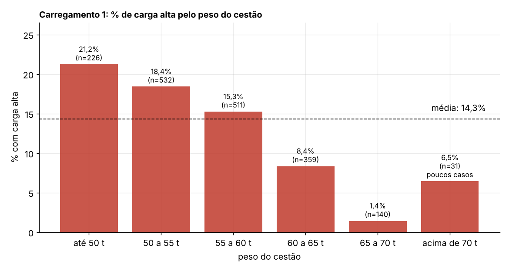

# Previsão de carga alta no forno elétrico a arco

Projeto final do bootcamp de Ciência de Dados do Fundo Amanhã, feito com dados reais da **EVCOMX**.

## Equipe

| | |
|---|---|
| Geórgia Muniz | Ciência da Computação |
| Lucas Talamini | Estatística |
| Mateus Schenato | Ciência da Computação |
| Teresa Bauer | Engenharia Elétrica |

**Professor:** Fabrício Leal (Fundo Amanhã, Diretor Executivo e Vice-presidente)

---

## O problema

Numa aciaria, a sucata entra no forno elétrico a arco (FEA) em cestões, montados em camadas de material leve, misto e pesado. Às vezes o cestão fica "alto" demais e o forno precisa parar para acomodar a carga. A pergunta do projeto é simples:

> Olhando só para a receita do cestão, dá para saber antes se ele vai dar carga alta?

É um problema de classificação (sim ou não), com uma classe rara: só cerca de **15 a 18% dos cestões** têm carga alta.

<p align="center">
  
</p>
<p align="center"><sub>Um dos primeiros achados da EDA: quanto mais pesado o cestão, menos carga alta. Abaixo de 55 t, a taxa passa da média; entre 65 e 70 t, cai para 2%.</sub></p>

---

## O caminho

O projeto foi feito em quatro etapas, uma pasta para cada. Cada etapa lê o que a anterior gerou, então a ordem importa.

```
original_dataset/  →  EDA/  →  feature_selection/  →  selecao_algoritmos/  →  analise_modelos/
  dados brutos       limpeza     80 candidatas          4 algoritmos            métricas, custo
                     e gráficos  → 9 features           → Random Forest         e tradução para
                                                                                 a operação
```

| Etapa | O que se fez | Detalhes |
|---|---|---|
| **EDA** | Junta as 4 tabelas, limpa (camadas de peso zero saem: o gancho não pegou o material), cria as primeiras features e investiga os dados. | [`EDA/README.md`](EDA/README.md) |
| **Feature selection** | Gera 80 features candidatas por cestão e escolhe 9 por votação entre seis métodos (filtro, RFE, L1, Elastic Net, permutação, Boruta). | [`feature_selection/README.md`](feature_selection/README.md) |
| **Seleção de algoritmos** | Compara regressão logística, árvore, Random Forest e Gradient Boosting com validação cruzada temporal. Fica a Random Forest. | [`selecao_algoritmos/README.md`](selecao_algoritmos/README.md) |
| **Análise de modelos** | Mede o modelo com as métricas certas, compara com regras simples e traduz os erros em alarmes e minutos de parada. | [`analise_modelos/README.md`](analise_modelos/README.md) |

Cada README de etapa tem as decisões, os números e as limitações com mais detalhe. Este aqui é o resumo.

---

## Os dados

São quatro arquivos fornecidos pela EVCOMX, cobrindo cerca de um ano de operação (ago/2025 a ago/2026):

- `infos_camadas.csv`: uma linha por camada de material em cada cestão (peso, horário, baia);
- `infos_materiais.csv`: densidade, rendimento metálico e energia de cada material;
- `dicionario_tipo_material.csv`: se cada material é leve, misto ou pesado;
- `VariavelResposta.csv`: se o cestão teve carga alta e quanto durou a parada.

A unidade de análise é o **cestão** (carregamento 1 ou 2 de cada corrida), o que dá uns 3.500 exemplos. A divisão é **70% treino / 15% validação / 15% teste, em ordem de tempo**, para que o modelo nunca aprenda com o futuro.

---

## O que encontramos

**As 9 features finais** têm leitura física direta: proporção de material pesado, densidade média do cestão, toneladas por ciclo de montagem, tamanho do maior bloco de leve, leve no fundo do cestão, dois tipos de pacote de chaparia e a taxa de carga alta nas últimas 5 e 10 corridas.

**O volume total não é o que importa.** Os cestões são enchidos até volumes parecidos; o que muda é quanto peso cabe nesse volume. O sinal está na densidade e na proporção de pesado.

**Carga alta puxa carga alta.** O histórico recente do forno é o sinal mais forte de todos. Uma regra que só olha esse histórico, sem modelo nenhum, já fica muito acima do chute.

**Maio de 2026 mudou o jogo.** A partir de maio há menos material pesado e menos ciclos por cestão. Modelos que iam bem antes disso pioram depois, e isso aparece em todas as etapas.
