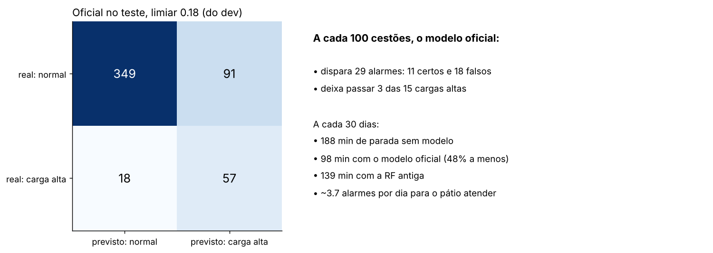
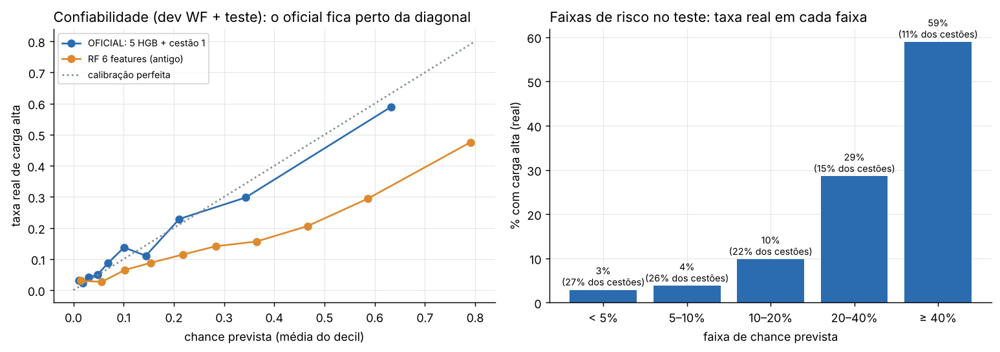

## Análise de Modelos e Métricas — Predição de Carga Alta (EVCOMX)

Segue a **Aula 06 do bootcamp** (Análise de Modelos e Métricas de Desempenho) e o **Guia de Modelagem Preditiva da EVCOMX** (§5), e continua `selecao_algoritmos/`. A seleção escolheu o modelo. Aqui medimos **o que ele entrega**, com as métricas certas, e traduzimos os erros para a língua da operação.

**Modelo analisado: o oficial**, a média de 5 Gradient Boosting com 121 features (120 + o resultado do cestão 1). Ao lado dele: a reserva (sem o cestão 1), a versão com histórico "lag2", a **RF de 6 features (o antigo plano A)** e a regra do histórico.

> **Antes (out/2026), esta pasta analisava a Random Forest de 6 features**, com custo em razão `k` (o custo do alarme falso ainda não era conhecido) e calibração de Platt. Está em [`historico_rf6/`](historico_rf6/README.md). O achado principal daquela rodada era "no teste, o modelo não se separa da regra do histórico". Com o modelo oficial, isso mudou em PR-AUC, mas não nos minutos (seção 11).

### Como rodar

1. As etapas anteriores, em ordem (a última é `selecao_algoritmos/selecao_algoritmos.py`).
2. `analise_modelos/analise_modelos.py` (células `#%%`) ou `analise_modelos.ipynb` (mesmo conteúdo, já executado). Leva ~1 min.

**Não escolhe nada.** Lê as previsões da seleção (`previsoes_dev_teste.csv`): no dev, as do walk-forward mensal (sempre fora da amostra); no teste, as dos modelos treinados no dev. Duas conferências automáticas: o oficial re-treinado aqui dá **as mesmas chances** da seleção, e os minutos do teste **batem** com `resultado_teste.csv`.

### Arquivos gerados

| Arquivo | O que é |
|---|---|
| `tabela_unica_dev.csv` / `tabela_unica_teste.csv` | **A tabela única do Guia (§5.5)**: modelos e baselines lado a lado em 12 métricas |
| `teste_traduzido.csv` | O teste a cada 100 cestões, a cada 30 dias e em alarmes por dia |
| `custo_por_limiar_teste.csv` | Minutos no teste conforme o limiar (oficial e RF antiga, TP=0 e TP=1) |
| `faixas_de_risco.csv`, `calibracao.csv` | Taxa real em cada faixa de chance; chance média × taxa real e Brier |
| `metricas_por_periodo.csv` | PR-AUC e minutos mês a mês (dev e teste) |
| `recall_em_minutos.csv` | Recall contado em eventos e em minutos de parada |
| `bootstrap_teste.csv` | A diferença é real? Bootstrap por dia, IC 90%, contra a RF antiga e contra a regra |
| `curva_de_aprendizado.csv` | PR-AUC na validação conforme os meses de treino |
| `desempenho_por_segmento.csv` | Cestão 1 × 2, com × sem gusa, histórico alto × baixo, densidade |
| `analise_erros_fn_fp.csv`, `casos_para_especialista.csv` | O que os erros têm em comum; os casos para revisar com o pátio |
| `graficos/` | 7 figuras |

### Passo a passo (slide 37 da aula)

1. **Qual erro custa mais caro?** Uma carga alta não detectada para o forno **3,9 min em média** (mediana 2,9; 10% passam de 8 min). Um alarme falso custa **1 min** (EVCOMX). Um FN custa ~4 FP, e os FN não são todos iguais.
2. **Métrica principal antes de testar:** minutos perdidos (régua de negócio) e PR-AUC (ordem dos cestões), declaradas antes de abrir o teste. A acurácia engana: no teste, quem nunca alarma acerta 85% e perde 251 min.
3. **Baselines na mesma métrica:** sem modelo e a regra do histórico.
4. **Tabela única**, curvas ROC e precisão-recall.
5. **Matriz de confusão** traduzida.
6. **Corte pelo custo.**
7. Extras: calibração, estabilidade no tempo, bootstrap, diagnóstico de erros.

### Tabela única (Guia §5.5)

**Teste (24/jun a 4/ago/2026, 515 cestões, 75 cargas altas):**

| Modelo | PR-AUC | ROC-AUC | Recall | Precisão | F2 | MCC | Brier | Alarmes/100 | Minutos | Economia |
|---|---|---|---|---|---|---|---|---|---|---|
| **OFICIAL** | **0,567** | **0,844** | 0,76 | 0,39 | **0,64** | 0,43 | **0,090** | 29 | **131** | **48%** |
| Reserva (sem o cestão 1) | 0,443 | 0,831 | 0,65 | 0,39 | 0,58 | 0,40 | 0,099 | 24 | 165 | 34% |
| 5 HGB, histórico lag2 | 0,436 | 0,806 | 0,68 | 0,41 | 0,60 | 0,42 | 0,103 | 24 | 148 | 41% |
| RF 6 features (antigo) | 0,404 | 0,785 | 0,69 | 0,35 | 0,58 | 0,37 | 0,155 | 29 | 186 | 26% |
| Regra do histórico | 0,358 | 0,790 | 0,72 | 0,41 | 0,63 | 0,44 | 0,161 | 25 | 147 | 41% |
| Sem modelo | 0,146 | 0,500 | 0 | — | 0 | 0 | 0,124 | 0 | 251 | 0% |

**Dev (walk-forward, jan–jun/2026, limiar de cada mês vindo do passado):**

| Modelo | PR-AUC | Recall | Precisão | Brier | Minutos (de 950) | Economia |
|---|---|---|---|---|---|---|
| **OFICIAL** | **0,500** | 0,63 | 0,37 | **0,109** | **616** | **35%** |
| Reserva | 0,424 | 0,70 | 0,33 | 0,117 | 622 | 35% |
| 5 HGB, lag2 | 0,419 | 0,57 | 0,36 | 0,118 | 643 | 32% |
| RF 6 features (antigo) | 0,413 | 0,52 | 0,31 | 0,147 | 751 | 21% |
| Regra do histórico | 0,281 | 0,52 | 0,27 | 0,191 | 816 | 14% |

### O teste traduzido para a operação (gráfico 02)

A cada 100 cestões, o oficial dispara **29 alarmes** (11 certos, 18 falsos) e deixa passar **3 ou 4 das 15 cargas altas**. A cada 30 dias: **188 min** de parada sem modelo, **98 min** com o oficial, 139 com a RF antiga. São **~3,7 alarmes por dia** para o pátio atender.

### Curvas e o corte pelo custo (gráficos 01 e 03)

- O oficial domina as curvas ROC e precisão-recall, principalmente na faixa de **recall 60–80%**, onde cai o limiar de menor custo.
- **O limiar do dev (0,178) caiu perto do melhor possível no teste:** 131 min, contra 124 min do melhor limiar que só se saberia olhando o teste (0,19).
- A RF antiga tinha chances infladas pelos pesos de classe: o limiar de menor custo dela fica em ~0,46.

### A "chance" é chance de verdade? (gráfico 04)

- **Sim, sem calibração extra.** O oficial não usa pesos de classe: no dev, a chance média é 0,160 para uma taxa real de 0,163; no teste, 0,165 para 0,146. A RF antiga dava 0,29–0,34 e precisava de Platt.
- **As faixas de risco ficam em ordem no teste**, e servem para mostrar ao pátio:

| Faixa de chance | % dos cestões (teste) | Taxa real (teste) | Taxa real (dev) |
|---|---|---|---|
| < 5% | 27% | 3% | 3% |
| 5–10% | 26% | 4% | 13% |
| 10–20% | 22% | 10% | 13% |
| 20–40% | 15% | 29% | 26% |
| ≥ 40% | 11% | **59%** | **55%** |

### O desempenho se mantém no tempo? (gráfico 05)

O oficial economiza minutos em todos os meses do dev (de 13% em abr/26 a 50% em fev/26) e nos dois meses cheios do teste (48% em jun, 50% em jul). Agosto tem só 12 cestões e 2 cargas altas: o número não diz nada.

### Minutos: pega as paradas que mais doem?

| Modelo (teste) | Recall em eventos | Recall em minutos | Duração média das pegas | Das perdidas |
|---|---|---|---|---|
| **OFICIAL** | 76% | **84%** | 3,7 min | **2,2 min** |
| RF 6 features (antigo) | 69% | 65% | 3,1 min | 3,8 min |
| Regra do histórico | 72% | 72% | 3,3 min | 3,4 min |

O oficial pega mais as paradas longas, embora não preveja a duração: entre as cargas altas, a chance quase não se relaciona com a duração (Spearman +0,09). É o resultado do cestão 1 e da gusa que separam melhor as corridas de parada longa.

### A diferença é real ou sorte? (bootstrap por dia, IC 90%)

| Comparação no teste | Dif. PR-AUC | Dif. minutos | Ganha nos minutos em |
|---|---|---|---|
| **Oficial × RF antiga** | **+0,16 (+0,08 a +0,24)** | **−55 (−105 a −14)** | 99% dos sorteios |
| **Oficial × regra do histórico** | **+0,21 (+0,11 a +0,32)** | −17 (−59 a +21) | 74% dos sorteios |
| Reserva × RF antiga | +0,04 (−0,01 a +0,10) | −20 (−64 a +20) | 78% |

- **Contra a RF antiga, o oficial ganha nas duas réguas, fora do ruído.**
- **Contra a regra do histórico, ganha com folga em PR-AUC, mas nos minutos a diferença ainda cabe no ruído do teste** (só 75 cargas altas). No dev, com 6 meses e ~480 cargas altas, a diferença é grande (616 × 816 min). É a frase honesta para a apresentação: o modelo ordena muito melhor que a regra; no teste curto, a economia de minutos dos dois ainda se sobrepõe.

### Diagnóstico de erros (Guia §5.6)

**Curva de aprendizado** (treino → validação, gráfico 06): com 2 meses de treino a PR-AUC na validação é 0,31; com 6, 0,44; com 8, 0,47; com tudo (8,4 meses), 0,45. Mais dados ajudam até ~6 meses; os meses mais antigos (antes da mudança de maio) já não acrescentam.

**Por segmento** (dev jan–jun + teste, gráfico 07):

| Segmento | Taxa real | Recall | Precisão | Economia |
|---|---|---|---|---|
| Cestão 1 | 16% | 62% | 34% | 31% |
| Cestão 2 | 16% | 70% | 41% | **46%** |
| Com gusa líquida | 19% | 69% | 38% | 39% |
| Sem gusa líquida | 3% | **0%** | — | 0% |
| Histórico alto (> 40%) | 32% | 79% | 49% | **59%** |
| Histórico baixo | 11% | 54% | 29% | 18% |
| Densidade baixa | 21% | 80% | 37% | 45% |
| Densidade alta | 10% | 40% | 49% | 32% |

- **O cestão 2 é onde o modelo mais economiza**, por causa do resultado do cestão 1. (Na RF antiga era o contrário: o cestão 2 recebia alarmes demais.)
- **Sem gusa líquida, o modelo nunca alarma**: são 3% de carga alta, e as poucas que acontecem são curtas (31 min no total do dev + teste).
- **Com o forno calmo, o modelo é mais fraco** (economia de 18%). É o mesmo ponto cego da RF antiga: quando nada na história avisa, a receita sozinha diz pouco.

**Falsos negativos e falsos positivos** (`analise_erros_fn_fp.csv`): as cargas altas perdidas têm o perfil de cestão normal (histórico 40%, densidade 0,80, 28% de pesado) e paradas curtas (mediana 2,4 min); os alarmes falsos têm o perfil de risco (densidade 0,73, 19% de pesado). Os 20 casos mais claros estão em `casos_para_especialista.csv`, para revisar com o pátio.

### E as métricas de regressão?

Não se aplicam: o alvo é sim/não. A duração da parada não é prevista; ela entra como peso na régua de minutos.

### Conclusão: é bom o suficiente para uso operacional?

- **Contra a operação de hoje (sem alarme): sim.** No teste, 48% menos minutos (131 de 251), com ~3,7 alarmes por dia. No dev, 35%.
- **Contra a RF antiga: sim, fora do ruído**, nas duas réguas.
- **Contra a regra do histórico: ordena muito melhor (PR-AUC 0,57 × 0,36), mas a economia de minutos no teste ainda não se separa.** Vale medir de novo com o próximo lote.
- **A chance pode ir para o pátio como está** (calibrada), de preferência em faixas de risco.
- **O ganho depende do que o pátio faz com o alarme.** Se o alarme certo também custar 1 min, a economia no teste cai para 22% (verificação, seção 6.4).

### O que depende da EVCOMX

| Pergunta | O que muda aqui |
|---|---|
| O reajuste evita a parada inteira? O alarme certo custa 1 min? | A economia vai de 48% a ~22% |
| Quantos alarmes por dia o pátio aguenta? | ~3,7 por dia hoje; um teto troca recall por menos alarmes |
| Por que o cestão 2 dá menos carga alta quando o cestão 1 deu? | Explica a feature que mais ganha nos minutos |

### Limitações

- **Teste pequeno** (75 cargas altas; agosto com 12 cestões). Diferenças menores que ~40 min e ~0,08 de PR-AUC estão dentro do ruído.
- **"Minutos evitados" é o teto do ganho** (supõe que o alarme certo evita a parada inteira).
- **scikit-learn 1.9.1.**
