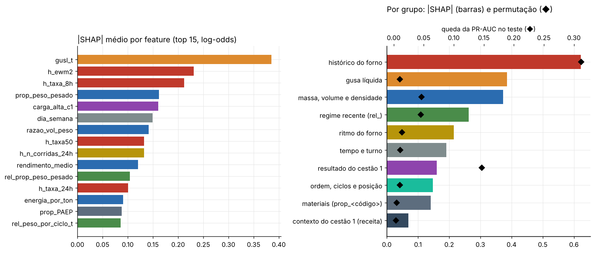
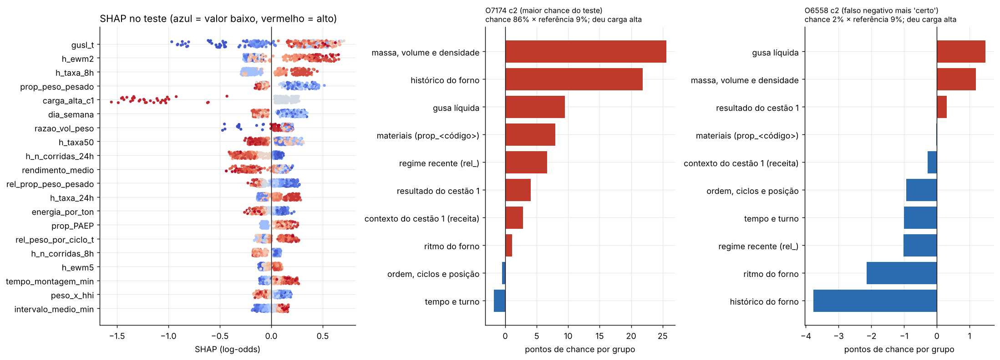

## Interpretação do Modelo (Explainable AI) — Predição de Carga Alta (EVCOMX)

Segue a **Aula 08 do bootcamp** (Interpretação de Modelos) e vem depois de `verificacao_validacao/`: primeiro se valida, depois se interpreta.

**Esta etapa não escolhe nada e não muda o modelo.** O modelo explicado é o **oficial**, a média de 5 Gradient Boosting com 121 features, **treinado no dev** (`selecao_algoritmos/modelo_dev.joblib`). As explicações são feitas no **teste** (24/jun a 4/ago/2026, 515 cestões, 75 cargas altas), que esse modelo nunca viu.

> **Antes (out/2026), esta pasta explicava a Random Forest de 6 features**, com Shapley exato "na mão" (2⁶ = 64 combinações). Está em [`historico_rf6/`](historico_rf6/README.md).

### Como rodar

1. As etapas anteriores, em ordem.
2. `interpretacao_modelos/interpretacao_modelos.py` (células `#%%`) ou `interpretacao_modelos.ipynb` (mesmo conteúdo, já executado). Leva ~1 min.

**SHAP sem o pacote `shap`.** Com 121 features não dá para enumerar as combinações (2¹²¹). O pacote `shap` não pôde ser instalado no ambiente onde o projeto rodou, então `treeshap_hgb.py` implementa o **TreeSHAP exato** do `shap.TreeExplainer` (modo "tree_path_dependent"), lendo as árvores do `HistGradientBoostingClassifier`. Três conferências:
- em todos os 515 cestões, **referência + soma dos SHAP = saída do modelo** (erro de 4e-15; o script para se não fechar);
- em 40 árvores, o resultado bate com o **Shapley calculado por força bruta**, combinação por combinação (diferença de 3e-17);
- se o `shap` estiver instalado na sua máquina (`pip install shap`), o script compara os dois e mostra a diferença.

O script também para se o modelo explicado não der exatamente as chances da seleção.

### Arquivos gerados

| Arquivo | O que é |
|---|---|
| `coeficientes_logistica.csv` | Logística de 10 features (caixa de vidro): coeficientes, odds e estabilidade em 300 reamostragens |
| `arvore_rasa_regras.txt` | Árvore de 3 níveis que **imita** o oficial, com a fidelidade |
| `importancia_global.csv`, `importancia_por_grupo.csv` | \|SHAP\| médio e permutação no teste, por feature e por grupo |
| `pdp_casos_impossiveis.csv` | Quantos pontos do PDP são combinações que não existem nos dados |
| `lime_estabilidade.csv` | LIME por grupo no falso negativo, 20 execuções, ao lado do SHAP |
| `contrafactuais_teste.csv`, `contrafactuais_resumo.csv` | Quantas toneladas de leve trocadas por pesado tirariam cada alarme |
| `vies_cestao1_cestao2.csv`, `motivo_dos_alarmes.csv` | Cestão 1 × 2; o que puxa cada alarme |
| `explicacoes_alarmes_teste.csv` | Os 148 alarmes e as 18 cargas altas perdidas do teste explicados em 3 frases |
| `treeshap_hgb.py` | O TreeSHAP para Gradient Boosting |
| `graficos/` | 4 figuras |

### Quem recebe a explicação (slide 9)

| Quem | O que quer saber | O que mostramos |
|---|---|---|
| O grupo e o professor | O modelo aprendeu algo errado? | Importância por grupo, PDP/ICE com casos impossíveis, SHAP × permutação, LIME |
| Gestão da EVCOMX | Posso confiar e agir com base nisso? | Os quatro sinais em linguagem de pátio, o que o modelo **não** sabe |
| Operador do pátio | Por que **este** cestão foi alarmado? O que eu mudo? | A explicação de 3 frases e o contrafactual em toneladas |
| Auditoria (a própria EVCOMX) | O modelo trata casos iguais de forma diferente? | Cestão 1 × cestão 2, o que puxa cada alarme |

---

### 1. Modelos transparentes, a "caixa de vidro" (slides 16 a 20)

**Logística com 10 features** (uma ou duas de cada grupo), padronizadas, treinada no dev:

| Feature | Coef. por desvio-padrão | Odds × por desvio-padrão | Sinal trocado nas reamostragens |
|---|---|---|---|
| `h_ewm2` (histórico recente) | +0,86 | **× 2,37** | 0% |
| `carga_alta_c1` (cestão 1 deu) | −0,45 | **× 0,64** | 0% |
| `gusl_t` (gusa líquida) | +0,35 | × 1,42 | 0% |
| `densidade_media` | −0,30 | × 0,74 | 1% |
| `prop_peso_pesado` | −0,28 | × 0,76 | 2% |
| `rendimento_medio` | −0,26 | × 0,77 | 0% |
| `eh_cestao_2` | +0,22 | × 1,25 | 0% |
| `peso_por_ciclo_t` | +0,19 | × 1,20 | 0% |
| `taxa_ca_ult10` | −0,13 | × 0,88 | 9% |
| `intervalo_medio_min` | +0,02 | × 1,02 | **33%** |

- **Leitura (slide 18):** a cada desvio-padrão a mais de histórico recente, as chances de carga alta mais que dobram. Se o cestão 1 deu carga alta, as do cestão 2 caem 36%. Gusa, densidade e pesado têm o sentido físico esperado.
- **Colunas parecidas (slide 17):** `taxa_ca_ult10` anda junto com `h_ewm2` e fica com "o que sobra" (sinal negativo, instável em 9%). O intervalo entre camadas não tem sinal confiável.
- **A logística de 10 features chega a PR-AUC 0,52 no teste** (o oficial, 0,57). O teste não serve para escolher, mas o dado reforça o que a seleção já registrou: uma versão simples fica perto, e vale reavaliá-la com o próximo lote.

**Árvore de 3 níveis que imita o oficial** (`arvore_rasa_regras.txt`): primeiro pergunta se o cestão tem mais de 20% de pesado; depois, o histórico recente; depois, o resultado do cestão 1, a gusa ou a densidade. Com pouco pesado, histórico agitado e cestão 1 sem carga alta, a chance média é **70%**; com o cestão 1 tendo dado carga alta, cai para 23%. **Fidelidade no teste: R² 0,62 e a mesma decisão de alarme em 83% dos cestões.** Serve para mostrar a lógica, não para substituir o modelo (PR-AUC 0,40).

### 2. Importância global: por feature e por grupo (slides 22, 23 e 38; gráfico 01)

| Grupo | \|SHAP\| médio | Permutação do grupo (queda PR-AUC no teste) | Soma das permutações individuais |
|---|---|---|---|
| **Histórico do forno** | **0,62** | **0,31** | 0,11 |
| Gusa líquida | 0,39 | 0,01 | 0,00 |
| Massa, volume e densidade | 0,37 | 0,05 | 0,03 |
| Regime recente (`rel_`) | 0,26 | 0,05 | 0,01 |
| Ritmo do forno | 0,22 | 0,01 | 0,00 |
| Tempo e turno | 0,19 | 0,01 | 0,00 |
| **Resultado do cestão 1** | 0,16 | **0,15** | 0,14 |
| Ordem, ciclos e posição | 0,15 | 0,01 | 0,00 |
| Materiais | 0,14 | 0,01 | 0,00 |
| Contexto do cestão 1 (receita) | 0,07 | 0,00 | 0,01 |

- **O histórico do forno é o maior sinal pelas duas réguas.** Embaralhado como grupo, a PR-AUC cai 0,31; somando as quedas das 18 colunas uma a uma, só 0,11. É o efeito das cópias (slide 38): uma coluna embaralhada é coberta pelas outras.
- **O resultado do cestão 1 é uma coluna só e pesa 0,15 na permutação.** No SHAP médio ele parece pequeno porque vale 0 em todo cestão 1 e na maioria dos cestões 2: quando é 1, empurra a chance para baixo com força (até −1,5 em log-odds).
- **As duas réguas discordam sobre a gusa:** SHAP alto, permutação baixa. A gusa separa muito bem as corridas **sem** gusa (quase nunca dão carga alta, gráfico 03), mas essas são poucas no teste (18 de 515): embaralhar a coluna mexe pouco na ordem.
- **Caso estranho:** `dia_semana` está no top 6 do SHAP. Não tem explicação física óbvia; pode ser um efeito de turno/equipe, ou ruído que o modelo aprendeu. Vale perguntar ao pátio se há diferença de rotina entre os dias.

### 3. PDP, ICE e os "casos impossíveis" (slides 24 a 26 e 38; gráfico 02)

| Feature | Sentido | Chance de… → … | Linhas ICE no mesmo sentido | Pontos do PDP em combinações quase inexistentes |
|---|---|---|---|---|
| `prop_peso_pesado` | desce | 0,19 → 0,15 | 95% | 24% (com a densidade parada) |
| `h_ewm2` | sobe | 0,14 → 0,24 | 100% | **59%** (com `taxa_ca_ult5` parada) |
| `gusl_t` | sobe | 0,08 → 0,17 | 100% | 3% |
| `densidade_media` | desce | 0,17 → 0,15 | 100% | 27% |

- Os sentidos batem com a física e com a verificação (seção 6.3).
- **Os efeitos parecem pequenos no PDP porque ele mexe numa coluna só.** Mudar só `prop_peso_pesado`, com a densidade, as `rel_` e o peso por ciclo parados, cria cestões que não existem (24% dos pontos). Para o histórico, 59%: um forno com média exponencial alta e nenhuma carga alta nas últimas 5 corridas não acontece. A forma da curva vale como ilustração; o tamanho, não. Por isso o contrafactual (seção 6) recalcula a receita inteira.

### 4. SHAP (slides 28 a 31; gráfico 03)

A referência é a saída média do modelo na escala dele, equivalente a **~9% de chance** (a média das chances é ~16%; poucos cestões de risco alto puxam a média). Para falar em **pontos de chance**, a diferença "chance do cestão − referência" é dividida entre os grupos na proporção dos SHAP de cada grupo; a conta continua fechando.

- **O cestão de maior chance** (O7174 c2, chance 86%, deu carga alta, parada de 9 min): **0% de pesado e 0,64 t/m³** (+26 pontos), forno com 4 cargas altas nas últimas 5 corridas (+22), gusa (+10).
- **O falso negativo mais "certo"** (O6558 c2, chance 2%, deu carga alta): o modelo deixou passar porque **o forno estava calmo** (nenhuma carga alta nas últimas 5 corridas, −4 pontos) e o ritmo e o regime recente também seguravam. A receita era só levemente fofa (0,77 t/m³, 17% de pesado). Nada no que o modelo vê indicava risco: é o ponto cego já visto na análise (forno calmo = economia de 18%).

### 5. LIME (slides 32 a 34; gráfico 04)

No mesmo falso negativo, **por grupo** (com 121 colunas, perturbar coluna a coluna cria cestões impossíveis), 20 execuções:
- **Os três grupos principais são os mesmos do SHAP e não trocam de sinal:** histórico (−8 pontos no LIME, −4 no SHAP), ritmo e gusa.
- **Os grupos pequenos são instáveis:** materiais, resultado do cestão 1 e ordem/ciclos trocam de sinal em 25–35% das execuções. É a instabilidade do slide 34.
- **LIME e SHAP respondem perguntas diferentes:** o LIME mede para onde o modelo é sensível perto deste cestão; o SHAP divide a conta deste cestão. Para explicar um caso ao pátio, o SHAP é o certo, porque a conta fecha.

### 6. Contrafactuais: o que mudaria o alarme? (slide 35)

Para os 148 cestões alarmados no teste: quantas toneladas de leve trocadas por pesado (gusa sólida, no topo) tirariam o cestão do alarme? A receita é **recalculada inteira**, como no app (densidade, proporções, ciclos, posição e `rel_` mudam juntas). Histórico, gusa líquida e resultado do cestão 1 não se mudam na montagem.

| Forno | Alarmes | Saem do alarme com até 15 t | Toneladas, mediana |
|---|---|---|---|
| Calmo (< 2 cargas altas nas últimas 5) | 33 | **82%** | **1 t** |
| Agitado (≥ 2 nas últimas 5) | 115 | 48% | 4 t |
| Todos | 148 | 55% | 3 t |

- **Com o forno calmo, o alarme é quase sempre "da receita"**, e pouco pesado a mais resolve. Com o forno agitado, metade dos alarmes não sai nem com 15 t: o risco vem do histórico, que a montagem não muda.
- **Versão ingênua** (só `prop_peso_pesado` sobe, o resto parado): pede uma mediana de +12 pontos percentuais de pesado, e gera exatamente o tipo de cestão impossível da seção 3.
- **Isto não é uma receita para o pátio.** É o que mudaria a resposta **do modelo**. Se trocar 3 t de leve por pesado evita a carga alta no forno de verdade é uma pergunta de causa, que só um piloto responde (`otimizacao_minutos/`, cenário 2).

### 7. Viés e casos estranhos (slide 39)

| | Cestões | Taxa real | Alarmes | Recall | Precisão | \|SHAP\| receita | \|SHAP\| histórico |
|---|---|---|---|---|---|---|---|
| Cestão 1 | 270 | 14% | 27% | 0,79 | 0,41 | 0,41 | 0,58 |
| Cestão 2 | 245 | 15% | 30% | 0,73 | 0,37 | 0,66 | 0,67 |

- **O desequilíbrio da RF antiga sumiu.** Ela dava alarme em 40% dos cestões 2 contra 28% dos cestões 1, com a mesma taxa real; o oficial fica em 30% × 27%. O resultado do cestão 1 e o contexto do cestão 1 explicam o cestão 2 sem precisar "ler pouco pesado como risco".
- **O que puxa cada alarme** (`motivo_dos_alarmes.csv`): **47% pela receita**, 43% pelo histórico, 10% pela gusa. Os alarmes do histórico acertam um pouco mais (precisão 0,41 × 0,39).
- Caso estranho: o peso do dia da semana (seção 2).

### 8. Traduzir para o negócio (slide 40)

Cada alarme e cada carga alta perdida do teste tem uma explicação de 3 frases (`explicacoes_alarmes_teste.csv`). Exemplos:

> **O7174 c2 (alarme, deu carga alta):** Risco alto: o modelo deu 86 pontos de chance, contra 9 do cestão de referência. O que mais aumentou o risco: cestão fofo (0,64 t/m³, 0% de pesado) e forno com carga alta recente (4 das últimas 5 corridas). O que segurou o risco: montagem de 12 min.

> **O6558 c2 (falso negativo):** Risco baixo: o modelo deu 2 pontos de chance, contra 9 do cestão de referência. O que mais aumentou o risco: 32 t de gusa líquida na corrida e cestão fofo (0,77 t/m³, 17% de pesado). O que segurou o risco: forno calmo (0 carga alta nas últimas 5 corridas).

**Antes e depois (slide 40):**

| Antes | Depois |
|---|---|
| "O grupo histórico tem \|SHAP\| médio de 0,62 e `carga_alta_c1` derruba a PR-AUC em 0,15 quando embaralhada." | "O que mais pesa é se o forno teve carga alta nas últimas corridas e se o cestão 1 desta corrida já deu carga alta (aí o cestão 2 costuma ir bem). Depois vêm a gusa e quanto pesado tem no cestão." |
| "O contrafactual mediano é 3 t." | "Com o forno calmo, trocar ~1 t de leve por pesado costuma tirar o alarme. Com o forno agitado, a montagem resolve só metade das vezes. Isso é o que o modelo diz, não uma garantia do forno." |

### Os limites (slides 37 e 38)

- **Explicar o modelo não é explicar o forno.** O histórico é o maior sinal, mas é sintoma, não causa.
- **Colunas correlacionadas dividem o crédito.** Leia por grupo, não por coluna.
- **PDP e contrafactual ingênuo avaliam o modelo onde ele nunca esteve.** Por isso o contrafactual usado recalcula a receita.
- **SHAP em log-odds, pontos de chance por proporção.** A divisão em pontos de chance é uma convenção para comunicar; a conta exata é a de log-odds.

### O que depende da EVCOMX

| Pergunta | Muda o quê |
|---|---|
| Por que o cestão 2 dá menos carga alta quando o cestão 1 deu? | Explica o sinal mais forte depois do histórico |
| O dia da semana muda a rotina do pátio? | Diz se `dia_semana` é sinal real ou ruído |
| Trocar leve por pesado é viável na montagem? Quanto custa? | Diz se o contrafactual vira ação |
| As explicações de 3 frases fazem sentido para o pátio? | O teste do "Para discutir" da aula |

### Limitações

- **TreeSHAP próprio.** Conferido pela conta que fecha e contra o Shapley por força bruta; a comparação com o pacote `shap` roda só onde ele estiver instalado.
- **Explicações no teste, com o modelo treinado no dev.** O modelo para uso (todos os dados) é outro ajuste da mesma receita.
- **scikit-learn 1.9.1.**
