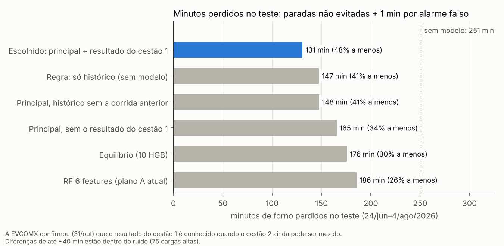

## Otimização por minutos perdidos (out/2026)

Depois da interpretação, a EVCOMX deixou claro o critério de negócio: **o melhor modelo é o que faz perder menos minutos de forno**, e não necessariamente o que acha mais cargas altas. Esta etapa refaz a modelagem com esse critério, sem deixar de acompanhar a PR-AUC.

> **Atualização (31/out/2026).** A EVCOMX confirmou que, quando o cestão 2 ainda pode ser mexido, já se sabe se o cestão 1 da mesma corrida deu carga alta. Com isso, **o modelo escolhido passa a ser o finalista que usa o resultado do cestão 1**. No teste, ele tem PR-AUC **0,567** e **131 min perdidos, 48% a menos** que sem modelo; a RF do grupo tem 0,404 e 186 min.
>
> Esse finalista já tinha sido registrado antes de abrir o teste, com a condição "se a EVCOMX confirmar". Por isso o número do teste continua honesto: nada foi re-escolhido depois de ver o teste.

### A régua: minutos perdidos

| Situação | Minutos perdidos |
|---|---|
| Carga alta sem alarme (FN) | a duração real daquela parada (`VariavelResposta.csv`) |
| Alarme falso (FP) | 1 min, o tempo de reajustar a montagem (resposta do Guima) |
| Alarme certo (TP) | 0 min no cenário principal. No cenário **TP=1**, o reajuste também custa 1 min |
| Sem modelo | a soma de todas as paradas |

Com uma parada média de ~4 min e alarme de 1 min, compensa alarmar um cestão quando a chance de carga alta passa de ~20%. **O limiar não é 0,5: ele é escolhido para dar o menor número de minutos.**

### Protocolo (para os números serem honestos)

1. **Toda escolha usa só treino + validação** (o "dev", ago/25 a jun/26):
   - **walk-forward mensal:** para cada mês de nov/25 a jun/26, o modelo treina com tudo o que veio antes e prevê o mês;
   - **a prova de sempre:** treina no treino e prevê a validação.
2. **O limiar de cada mês vem só dos meses anteriores** (o de menor minutos), como seria na operação. Os minutos do dev contam de jan a jun/26: **950 min de parada sem modelo**.
3. **Os finalistas foram registrados antes de abrir o teste** (`finalistas_dev_pre_registro.csv`). O critério declarado também foi fixado antes: o principal é o de **menos minutos** no dev, com PR-AUC no walk-forward pelo menos igual à da RF do grupo.
4. **O teste (24/jun a 4/ago/26) foi aberto uma única vez.** Cada modelo treinou no dev inteiro, e o limiar veio do dev.
   - **Transparência:** o grupo já tinha visto este teste nas rodadas anteriores. Por isso nada foi escolhido olhando o teste.

### O que foi tentado (92 configurações, todas em `experimentos/experimentos_log.csv`)

| Ideia | Ajudou? |
|---|---|
| Histórico mais rico: últimas 3/5/10/20/50 corridas, médias exponenciais, última corrida, corridas desde a última carga alta, taxa nas últimas 8 h e 24 h | Sim, um pouco (PR-AUC +0,01 a +0,02) |
| Gusa líquido da corrida (`gusl_t`, carregamento 3) | Sim, um pouco |
| **Gradient Boosting com as 84 candidatas + as novas (120 features)** | **Sim, nos minutos** (ver abaixo) |
| Resultado do cestão 1 no cestão 2 (`carga_alta_c1`) | **Muito.** A EVCOMX confirmou que o timing permite |
| Risco recente por material e por baia (taxa de carga alta nos últimos usos de cada pilha) | Não: repete o histórico |
| Peso (t) de cada material, volume e densidade das últimas camadas (topo) | Não |
| Pesos por recência e janelas de 3 ou 6 meses (por causa da mudança de maio) | Não (dentro do ruído) |
| Dar mais peso às cargas altas longas, ou modelar a duração da parada | Não. **A duração não é previsível com estes dados** (\|Spearman\| < 0,1 com todas as features) |
| Random Forest, Extra Trees, logística com splines, Gradient Boosting com monotonia física, combinações | Gradient Boosting foi o melhor; a monotonia não mudou nada |

**Por que o Gradient Boosting com 120 features ganha nos minutos.** Ele quase empata em PR-AUC com o modelo de 16 features, mas é melhor na faixa de **recall entre 60% e 80%**. É exatamente aí que cai o limiar de menor custo (precisão marginal de ~20%).

| Walk-forward jan–jun, precisão quando o recall é… | 20% | 40% | 60% | 70% | 80% |
|---|---|---|---|---|---|
| RF 6 features (grupo) | 0,44 | 0,36 | 0,30 | 0,27 | 0,24 |
| HGB 16 features | **0,55** | 0,41 | 0,33 | 0,30 | 0,26 |
| HGB 120 features | 0,44 | 0,41 | **0,36** | **0,34** | **0,28** |

A vantagem nos minutos é robusta: as **6 variações de hiperparâmetro** dessa família deram de 600 a 635 min no dev (a RF do grupo deu 751), e o ganho aparece em 5 dos 6 meses.

### O modelo escolhido

**Média das probabilidades de 5 `HistGradientBoostingClassifier`** com hiperparâmetros levemente diferentes (`learning_rate` 0,03–0,05, 8–16 folhas, `min_samples_leaf` 20–40, `l2_regularization=5`), sem pesos de classe.

- **Features:** as 120 de `features_finais.json` + `carga_alta_c1`. No cestão 2, `carga_alta_c1` é o resultado do cestão 1 da mesma corrida; no cestão 1, vale 0, e `eh_cestao_2` separa os dois casos.
- **Sem pesos de classe**, as chances saem quase calibradas, e o limiar escolhido no passado continua valendo no modelo re-treinado.
- **Reserva:** a mesma média, sem `carga_alta_c1`, para quando o resultado do cestão 1 faltar.

**O que o resultado do cestão 1 diz.** Quando o cestão 1 dá carga alta, o cestão 2 da mesma corrida dá **menos**: 10,6% contra 19,2% no dev, e 9,1% contra 16,0% no teste. Uma hipótese é que o pátio já corrige o cestão 2, ou que a parada dá tempo de o cestão 1 fundir mais. Vale perguntar à EVCOMX.

### Resultados no dev (registrados antes do teste)

| Modelo | PR-AUC validação | PR-AUC walk-forward | Min. perdidos jan–jun (de 950) | Economia | Economia (TP=1) |
|---|---|---|---|---|---|
| Principal: 5 HGB, 120 features | 0,383 | 0,424 | 618 | 35% | 19% |
| Equilíbrio: principal + 5 HGB de 16 features | 0,440 | **0,461** | 700 | 26% | 15% |
| **Escolhido: principal + resultado do cestão 1** | **0,450** | **0,500** | **615** | **35%** | **20%** |
| Principal com histórico "seguro" (lag 2) | 0,386 | 0,418 | 643 | 32% | 19% |
| RF 6 features (plano A do grupo) | 0,427 | 0,413 | 751 | 21% | 9% |

### Resultado no teste (aberto uma vez)

Teste: 515 cestões, 75 cargas altas e **251 min de parada em 40 dias**. Todos os modelos foram treinados no dev inteiro. A RF do grupo aparece aqui com o mesmo protocolo, re-treinada em treino + validação; por isso ela tem PR-AUC de 0,404 aqui, contra 0,391 no README da seleção, onde treinava só no treino.

| Modelo | PR-AUC teste | Min. perdidos | Economia | Economia (TP=1) | Alarmes / 100 | Recall | Precisão |
|---|---|---|---|---|---|---|---|
| Principal (sem o cestão 1, reserva) | 0,443 | 165 | 34% | 15% | 24 | 65% | 39% |
| Equilíbrio | 0,437 | 176 | 30% | 19% | 37 | 79% | 31% |
| **Escolhido: principal + resultado do cestão 1** | **0,567** | **131** | **48%** | **22%** | 29 | 76% | 39% |
| Principal com histórico "seguro" (lag 2) | 0,436 | 148 | 41% | 18% | 24 | 68% | 41% |
| RF 6 features (plano A do grupo) | 0,404 | 186 | 26% | 14% | 29 | 69% | 35% |
| Regra: só o histórico (`taxa_ca_ult5` > 0,5) | 0,358 | 147 | 41% | 20% | 25 | 72% | 41% |

Incerteza (bootstrap por dia, IC 90%, diferença contra a RF do grupo):

| Modelo | Dif. PR-AUC | Dif. minutos |
|---|---|---|
| Principal | +0,04 (−0,01 a +0,10) | −20 (−64 a +20) |
| **Escolhido (com o cestão 1)** | **+0,16 (+0,08 a +0,24)** | **−55 (−101 a −12)** |
| Principal lag 2 | +0,03 (−0,03 a +0,09) | −37 (−90 a +10) |
| Regra do histórico | −0,05 (−0,14 a +0,03) | −38 (−75 a −8) |

### Leitura honesta

1. **A PR-AUC subiu, mas pouco:** de 0,404 para 0,443 no teste e de 0,413 para 0,424 no walk-forward. O intervalo da diferença ainda encosta no zero.
2. **Os minutos caíram:**
   - no teste, de 186 para 165 min (−20 min em 40 dias, ~15 min a cada 30 dias);
   - no dev, de 751 para 618 min.
   - No teste, com só 75 cargas altas, a diferença **não é conclusiva** (IC −64 a +20). No dev a evidência é mais forte: 6 meses e ~480 cargas altas, consistente em 5 dos 6 meses.
3. **A regra do histórico empatou com os modelos no teste (147 min), mas foi a pior no dev (816 min, 14% de economia).** O ganho dela no teste parece sorte do período, mas mostra duas coisas:
   - o histórico domina o problema;
   - diferenças de até ~40 min no teste estão dentro do ruído.
4. **O ganho grande e claro é o resultado do cestão 1, e a EVCOMX confirmou que ele está disponível.** No teste, a PR-AUC vai a 0,57 e os minutos caem 48%. As duas diferenças contra a RF ficam fora do ruído (os intervalos não cruzam o zero). É o modelo escolhido.
5. **O modelo não depende de o resultado da corrida anterior estar pronto.** Usando só o histórico até a corrida N−2, ele perde pouco no dev (643 contra 618 min) e foi até melhor no teste.
6. **Se o alarme certo também custar 1 min (TP=1), a economia cai para 15–22%.** A pergunta 3 para a EVCOMX resolve isso.

### O que perguntar à EVCOMX

1. Quando o cestão da corrida N termina de ser montado, já se sabe se a corrida N−1 deu carga alta?
2. ~~Quando o cestão 2 ainda pode ser mexido, já se sabe se o cestão 1 da mesma corrida deu carga alta?~~ **Respondida em 31/out: sim.** Virou o modelo escolhido.
   - Nova pergunta: por que o cestão 2 dá menos carga alta quando o cestão 1 deu? O pátio corrige o cestão 2?
3. Quando o alarme está certo, o reajuste de 1 min evita a parada inteira? Esse 1 min também conta?
4. O que o pátio faz com um alarme, e quantos alarmes por turno ele consegue atender?
5. O gusa líquido entra antes ou depois dos cestões, e a quantidade é conhecida antes da montagem?
6. Existe registro de lote, fornecedor ou qualidade da sucata por baia?
7. A duração da parada depende de algo operacional?
8. A previsão seria usada no fim da montagem ou camada a camada?

### Como rodar

1. `python otimizacao_minutos/features_minutos.py` gera o `dataset_minutos.csv` a partir de `feature_selection/dataset_features_completo.csv`, `EDA/base.csv` e `original_dataset/VariavelResposta.csv`.
2. `python otimizacao_minutos/modelo_minutos.py` roda o walk-forward, o teste, o bootstrap, o gráfico e salva o modelo (~3–6 min).

### Arquivos

| Arquivo | O que é |
|---|---|
| `features_minutos.py`, `dataset_minutos.csv` | As features novas e a tabela completa |
| `features_finais.json` | As 120 features do principal, as 108 da versão lag 2 e as 5 variações de hiperparâmetro |
| `modelo_minutos.py` | O script reprodutível desta etapa |
| `finalistas_dev_pre_registro.csv` | Números do dev, salvos antes de abrir o teste |
| `resultado_teste_final.csv`, `bootstrap_teste_final.csv` | Teste e incerteza |
| `modelo_minutos.joblib` | Dois pacotes re-treinados com **todos** os dados (treino + validação + teste), cada um com as features e os limiares de menor minutos: `com_cestao1` (o escolhido; TP=0: 0,183, TP=1: 0,300) e `sem_cestao1_reserva` (TP=0: 0,181, TP=1: 0,218) |
| `graficos/01_minutos_perdidos_teste.png` | O gráfico acima |
| `experimentos/` | Registro da exploração: os scripts usados e o log das 92 configurações (`experimentos_log.csv`). Inclui `teste_retreino_mensal.csv`: com re-treino mensal dentro do teste, o principal fica em 0,456 de PR-AUC e 173 min, e a RF em 0,397 e 186 min. Os scripts de lá esperam estar numa pasta `exp/` na raiz; eles são registro, não precisam ser rodados |

### Rodada 2 (31/out): tentar melhorar o modelo com o cestão 1

Mais 76 configurações (168 no total, todas em `experimentos/experimentos_log.csv`), de novo escolhidas só no walk-forward de treino + validação:

| Ideia | Resultado no dev |
|---|---|
| Tirar grupos de features (ritmo, tempo, materiais, `rel_`, gusa) | Tudo dentro do ruído (PR-AUC 0,485–0,512; 588–658 min) |
| Histórico no nível do cestão (`hc_`): o cestão 2 vê o cestão 1, e o histórico separa cestão 1 e cestão 2 | +0,008 de PR-AUC, −15 min (ruído) |
| Um modelo para o cestão 1 e outro para o cestão 2 | Pior nos minutos (660) |
| **5 HGB grandes (com `hc_`) + 5 HGB pequenos (19 features)** | **PR-AUC 0,533 contra 0,500, minutos iguais (614)**. Melhor em validação (0,499 × 0,450) e em abr–jun (0,456 × 0,430) |
| Somar RF ou os modelos separados à combinação | Não melhora mais |

**Segunda olhada no teste**, só para o candidato escolhido no dev (`experimentos/teste_segunda_olhada.py`):

| | PR-AUC | Limiar (do dev) | Recall | Precisão | FN | FP | Minutos |
|---|---|---|---|---|---|---|---|
| Escolhido (5 HGB com o cestão 1) | 0,567 | 0,18 | 76% | 40% | 18 | 85 | 125 |
| Combinação grande + pequeno | 0,567 | 0,23 | 64% | 38% | 27 | 77 | 158 |

**O ganho de PR-AUC do dev não apareceu no teste** (diferença +0,003, IC 90% de −0,02 a +0,03). E o limiar mais alto que o dev escolheu para a combinação fez perder mais minutos no teste. **O modelo escolhido continua o mesmo.**

Os números do escolhido nesta tabela (125 min, F1 0,53) vêm da rodada exploratória e diferem um pouco dos do script limpo (131 min, F1 0,51) pelo arredondamento do CSV (ver Limitações).

Conclusão: com estes dados, o modelo chegou ao platô. Novas variações mexem a PR-AUC em ±0,02, menos que o ruído. Testar até alguma dar sorte no teste só inflaria o número.

### E se a operação mudasse? Três cenários (`cenarios_operacionais.py`)

O modelo fica igual. A pergunta é: que mudança barata na regra de negócio reduziria os minutos? Simulação de nov/25 a ago/26 (276 dias, 419 cargas altas, ~175 min de parada a cada 30 dias).

- **Política (cenários 1 e 3):** as previsões vêm do walk-forward e do teste, e o limiar é escolhido no dev.
- **Montagem (cenário 2):** a estimativa vem de associações observadas. **Não prova causa**; serve para propor um piloto na usina.

**Cenário 1: pausa preventiva antes do cestão 2** (`cenario1_*.csv`)

Há um experimento natural nos dados. Quando o cestão 1 parou por carga alta, o cestão 2 da mesma corrida deu carga alta **10%** das vezes, contra **19%** quando não parou.
- **Paradas curtas já bastam:** com o cestão 1 parado até 2 min, a taxa no cestão 2 foi de 11%.
- **O efeito se mantém dentro das faixas** de densidade e de histórico. No cestão 2 leve, foi de 32% para 8%; com histórico alto, de 34% para 13%.

A ideia testada: quando o modelo alarma o cestão 2, o forno faz uma pausa (ou acomoda a carga) antes de carregá-lo.

| Política | Min. perdidos / 30 dias | Economia | Ações / dia |
|---|---|---|---|
| Sem modelo | 175 | – | – |
| **Atual: alarme → reajuste (1 min, evita a parada inteira)** | **103** | **41%** | 2,5 |
| Atual, se o alarme certo também custar 1 min | 133 | 24% | 2,0 |
| Cestão 2 com pausa de 1 min (−45%), cestão 1 com reajuste | 150 | 14% | 1,7 |
| Idem, com efeito otimista (−60%) | 142 | 19% | 1,9 |

**Leitura:** como substituta do reajuste, a pausa **perde**. Ela só reduz o risco, enquanto o reajuste supõe que evita a parada inteira. Mas ela é a única ação com efeito **medido** nos dados; a eficácia do reajuste é suposta. Vale perguntar à EVCOMX o que acontece nessa parada (acomodação da carga? tempo de fusão?). Se for algo que dá para fazer de propósito em 1–2 min, isso vira uma ação nova.

**Cenário 2: depois de uma carga alta, montar a corrida seguinte mais densa** (`cenario2_*.csv`)

- **A carga alta se repete:** depois de uma corrida com carga alta, a seguinte dá carga alta **54%** das vezes, contra 19% quando a anterior não deu.
- **Hoje o pátio não reage:** a corrida seguinte vem até um pouco *menos* densa (0,80 contra 0,83 t/m³).
- **Entre as corridas pós-carga-alta, a densidade pesa muito.** As acima de 0,85 t/m³ dão 0,24 carga alta por corrida, contra 0,71 das abaixo.
- **O efeito aparece dentro do mesmo mês** (0,35 contra 0,71) e em todas as faixas de histórico.

| Regra: densidade mínima depois de uma carga alta | Corridas alteradas / dia | Minutos evitados / 30 dias | % das paradas |
|---|---|---|---|
| 0,81 t/m³ (mediana) | 0,8 | 34–38 | 18–21% |
| **0,85 t/m³ (terço mais denso)** | **1,1** | **48–62** | **26–33%** |
| 0,92 t/m³ | 1,3 | 88–90 | 47–48% |

O primeiro número é a estimativa conservadora, comparando dentro do mesmo mês; o segundo, a do ano todo.

**Ressalvas:**
1. **Desde maio quase não há corridas densas.** Acima de 0,85 t/m³ eram ~45% das corridas até abril e caíram para 3–5% em jun–jul. Seguir a regra hoje pode exigir sucata mais pesada, e mais cara. Isso também ajuda a explicar a mudança de regime de maio.
2. **O efeito não é somável com o do modelo**, porque os dois agem sobre os mesmos cestões: o histórico alto já faz o modelo alarmar. A regra antecipa a ação para o planejamento da receita, antes de montar.
3. **Custo da sucata pesada: quando a regra se paga.** Mantendo o mesmo peso da corrida, chegar a 0,85 t/m³ exige trocar em média **~8 t de leve por pesado** (~9% da carga; metade das corridas fica entre 4 e 12 t). Cada corrida alterada evita **1,5–1,9 min** de parada. Então a regra se paga se **(preço do pesado − preço do leve) por tonelada < ~0,18–0,22 × o valor de 1 minuto de forno**. Esses dois preços precisam vir da usina.
   - **Versão sem comprar nada:** reservar a sucata pesada que já existe para a corrida que vem depois de uma carga alta, trocando a ordem de uso com uma corrida densa das 6 seguintes. Densificar depois de uma carga alta reduz 0,47 carga alta por corrida; depois de uma corrida normal, só 0,15. A troca ganha a diferença, **0,31**. Mas como corridas densas ficaram raras, só cabem ~0,33 trocas por dia: **~12 min evitados a cada 30 dias (~6%)**.
4. **É associação.** Corridas densas podem diferir em outras coisas. A forma honesta de confirmar é um **piloto**: aplicar a regra em dias alternados e comparar.

**Cenário 3: teto de alarmes por dia** (`cenario3_teto_alarmes.csv`)

| Teto / dia | Recall | Min. / 30 dias | Economia |
|---|---|---|---|
| 1 | 19% | 157 | 10% |
| 2 | 32% | 144 | 18% |
| 3 | 42% | 134 | 23% |
| 4 | 51% | 122 | 30% |
| sem teto (~2,5 alarmes/dia em média) | 66% | 103 | 41% |

A média é 2,5 alarmes por dia, mas há dias de pico. Um teto de 4 por dia já perde 11 pontos de economia. **Vale perguntar quantos alarmes o pátio aguenta nos dias cheios.**

### Limitações

- **Teste pequeno:** 75 cargas altas. Diferenças de minutos menores que ~40 min e de PR-AUC menores que ~0,08 não são confiáveis.
- **Muitas configurações testadas no dev (92).** O melhor resultado do dev tende a ser otimista. Por isso o principal é uma média de 5 variações, e não a melhor delas.
- **"Minutos evitados" supõe que o alarme certo evita a parada inteira.** É o teto do ganho.
- **Reprodução:** o script limpo lê as features de um CSV, e o arredondamento de ~1e-12 mudou um pouco dois finalistas em relação à rodada exploratória:
  - cestão 1: 131 contra 125 min no teste;
  - lag 2: 148 contra 145 min.
  - O principal saiu idêntico. As tabelas acima são as do script limpo.
- **scikit-learn 1.9.1.** Com outra versão, os números podem mudar um pouco.
