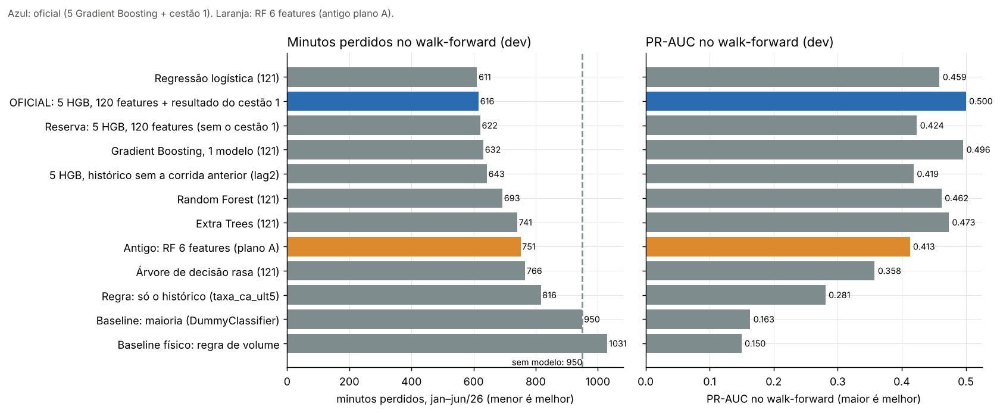
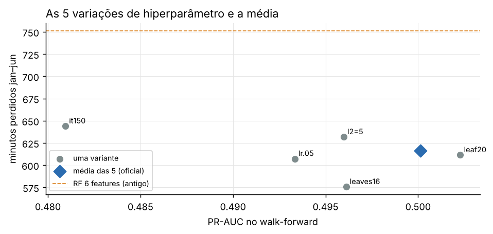
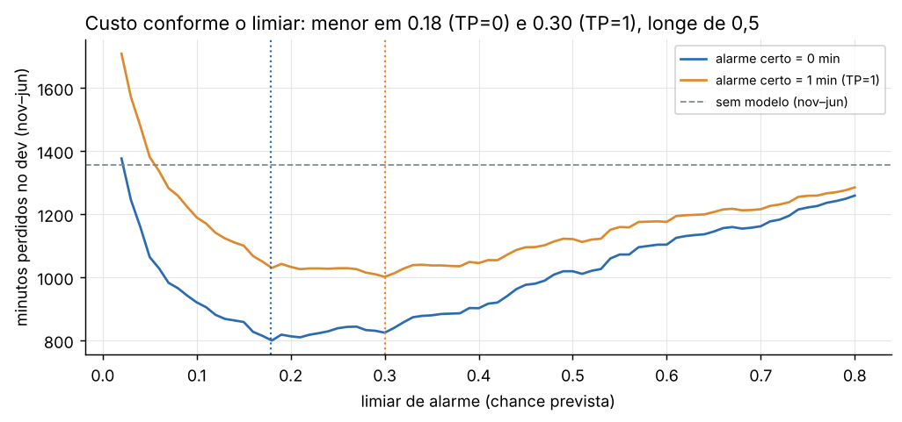
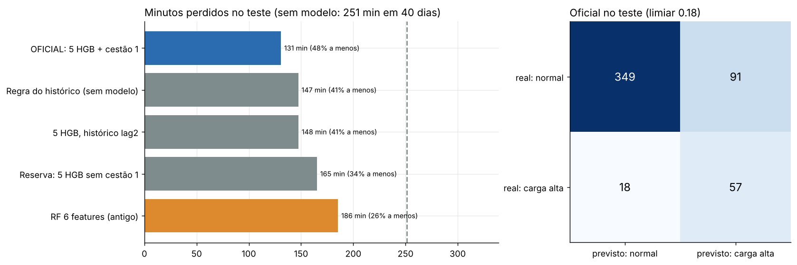

## Seleção de Algoritmos e Modelagem — Predição de Carga Alta (EVCOMX)

Segue a **Aula 05 do bootcamp** (Seleção de Algoritmos e Modelagem) e o **Guia de Modelagem Preditiva da EVCOMX** (§4), e continua `feature_selection/`.

**Algoritmo oficial: média das probabilidades de 5 `HistGradientBoostingClassifier`**, sem pesos de classe, com as **121 features oficiais** (120 + `carga_alta_c1`, o resultado do cestão 1).

> **Antes (out/2026), o escolhido era uma Random Forest com 6 features** (plano A), pela PR-AUC na validação. Está em [`historico_rf6/`](historico_rf6/README.md). A troca veio quando a EVCOMX deu o critério de negócio: **o melhor modelo é o que faz perder menos minutos de forno**. A RF continua aqui como linha de comparação.

### Como rodar

1. `EDA/transforma_dataset.py` e `feature_selection/feature_selection.py`.
2. `selecao_algoritmos/selecao_algoritmos.py` (células `#%%`) ou `selecao_algoritmos.ipynb` (mesmo conteúdo, já executado). Leva ~15 min.

O protocolo comum (régua de minutos, limiar, walk-forward e a receita dos 5 HGB) está em `comum/protocolo.py`. O script **para com erro** se a regra de escolha deixar de apontar para o oficial.

### Arquivos gerados

| Arquivo | O que é |
|---|---|
| **`modelo_final.joblib`** | **O modelo para uso**, re-treinado com todos os dados. Dois pacotes, cada um com os 5 modelos, as features e os limiares de menor minutos: `com_cestao1` (o oficial; limiar 0,183, ou 0,300 se o alarme certo também custar 1 min) e `sem_cestao1_reserva` (para quando o resultado do cestão 1 faltar; 0,181 / 0,218). É o arquivo que o app usa |
| `modelo_dev.joblib` | O oficial treinado só no dev; é o que a análise e a interpretação usam para explicar o teste |
| `modelo_final.json` | Receita, hiperparâmetros, features e limiares em texto |
| `previsoes_dev_teste.csv` | Chance de cada cestão no walk-forward (dev) e no teste, para cada finalista |
| `comparacao_algoritmos.csv` | Todos os algoritmos e baselines: minutos e PR-AUC no walk-forward, PR-AUC na validação |
| `variantes_hgb.csv`, `desbalanceamento.csv`, `escada_de_complexidade.csv` | As 5 variantes, pesos de classe × sem peso, a escada |
| `custo_por_limiar_dev.csv`, `limiares_dev.csv` | Custo conforme o limiar e os dois limiares |
| `resultado_teste.csv` | O teste, uma vez, para os finalistas |
| `graficos/` | 4 figuras |

### Passo a passo (slide 36 da aula)

1. **Classificação.** "Este cestão vai dar carga alta?" é sim ou não. A duração da parada não é prevista (nenhuma feature tem \|Spearman\| > 0,1 com ela): ela é o peso de cada carga alta perdida na régua.
2. **Métrica pelo custo do erro.** Carga alta perdida = a duração da parada (~4 min em média); alarme falso = 1 min (EVCOMX). **A métrica de escolha são os minutos perdidos**; a PR-AUC vem junto, como métrica principal do grupo para a ordem dos cestões. Compensa alarmar quando a chance passa de ~20%: o limiar não é 0,5.
3. **Separação e baselines.** Split 70/15/15 temporal por corrida. **Dev = treino + validação.** A comparação é por **walk-forward mensal**: para cada mês de nov/25 a jun/26, treina com tudo antes e prevê o mês; os minutos contam de jan a jun/26 (950 min sem modelo), com o limiar de cada mês vindo dos meses anteriores. Quatro réguas: sem modelo (maioria), a regra de volume do Guia, a **regra do histórico** e a logística.
4. **Algoritmos:** logística, árvore rasa, Random Forest (121 e a antiga de 6), Extra Trees, 1 Gradient Boosting e a média de 5.
5. **Comparação justa** no walk-forward (seção 6).
6. **Hiperparâmetros** (seção 7) e **desbalanceamento** (7b).
7. **Escada e regra de escolha** declaradas (seção 8).
8. **Limiar pelo custo** (seção 9).
9. **Teste uma vez** (seção 10).

### Resultado no walk-forward (dev)

| Modelo | Min. perdidos jan–jun (de 950) | Economia | PR-AUC walk-forward | PR-AUC validação |
|---|---|---|---|---|
| Regressão logística (121) | 611 | 36% | 0,459 | 0,350 |
| **OFICIAL: 5 HGB + resultado do cestão 1** | **616** | **35%** | **0,500** | **0,450** |
| Reserva: 5 HGB sem o cestão 1 | 622 | 35% | 0,424 | 0,383 |
| Gradient Boosting, 1 modelo | 632 | 34% | 0,496 | 0,436 |
| 5 HGB, histórico lag2 | 643 | 32% | 0,419 | 0,386 |
| Random Forest (121) | 693 | 27% | 0,462 | 0,467 |
| Extra Trees (121) | 741 | 22% | 0,473 | 0,452 |
| Antigo: RF 6 features (plano A) | 751 | 21% | 0,413 | 0,427 |
| Árvore de decisão rasa | 766 | 19% | 0,358 | 0,302 |
| Regra: só o histórico | 816 | 14% | 0,281 | 0,337 |
| Sem modelo (maioria) | 950 | 0% | 0,163 | 0,179 |
| Regra de volume (Guia) | 1.031 | −8% | 0,150 | 0,147 |

### A regra de escolha e a escada (seção 8)

- **Regra 1, declarada antes de abrir o teste** (`otimizacao_minutos/finalistas_dev_pre_registro.csv`): entre os finalistas, fica o de **menos minutos no walk-forward**, com PR-AUC pelo menos a da RF do grupo. Resultado: **o oficial** (616 min). O resultado do cestão 1 entrou com a condição "se a EVCOMX confirmar o timing", e a EVCOMX confirmou em 31/out/2026.
- **Regra 2, a escada (slide 33):** um degrau mais simples (linear < árvore < floresta < boosting) toma o lugar se **empatar nas duas réguas**: minutos a até 30 min e PR-AUC a até 0,02. Nenhum toma.
- **A regressão logística empata nos minutos (611 × 616), mas perde na ordem dos cestões:** PR-AUC 0,46 × 0,50 no walk-forward e 0,35 × 0,45 na validação, os dois fora do ruído. Ela não toma o lugar, mas fica registrada como a **alternativa simples** a reavaliar quando houver um lote novo de dados. Ela não é medida no teste: não era finalista, e o teste não serve para escolher.
- As florestas com 121 features não chegam perto nos minutos (693–741). O que faz a diferença é o Gradient Boosting, melhor justamente na faixa de recall de 60–80%, onde cai o limiar de menor custo.

### Por que a média de 5 (seção 7)

| Variante | PR-AUC WF | Min. jan–jun |
|---|---|---|
| `l2=5` | 0,496 | 632 |
| `lr=0,05` | 0,493 | 607 |
| `leaves=16` | 0,496 | **576** |
| `leaf=20` | 0,502 | 611 |
| `it=150` | 0,481 | 644 |
| **Média das 5 (oficial)** | **0,500** | **616** |

Escolher a melhor variante (576 min) seria otimista: com muitas tentativas, a melhor tende a ter sorte. A média depende menos de um ajuste específico. Ao todo, 168 configurações foram testadas na otimização (`otimizacao_minutos/experimentos/`).

### Desbalanceamento (seção 7b, Guia §4.4)

| Estratégia | PR-AUC WF | Min. jan–jun | Chance média | Taxa real |
|---|---|---|---|---|
| **sem peso (oficial)** | **0,500** | **616** | **0,160** | 0,163 |
| pesos de classe (`balanced`) | 0,492 | 654 | 0,299 | 0,163 |

Sem peso, a chance média fica igual à taxa real: **o modelo sai calibrado** e o limiar escolhido no passado continua valendo no modelo re-treinado. Com peso, a chance quase dobra e os minutos pioram. A RF antiga usava pesos e por isso precisava de calibração de Platt. Não usamos SMOTE: ele cria cestões que podem ser receitas impossíveis.

### Limiar de decisão (seção 9)

| Cenário | Limiar (do dev) |
|---|---|
| Alarme certo custa 0 min (principal) | **0,178** |
| Alarme certo também custa 1 min (TP=1) | 0,300 |

Os limiares do modelo para uso (0,183 e 0,300) são recalculados com as previsões do walk-forward + teste, sempre fora da amostra.

### Conferência no teste (24/jun a 4/ago/2026, uma única vez)

| Modelo | PR-AUC | Min. perdidos (de 251) | Economia | Economia se TP=1 | Alarmes / 100 | Recall | Precisão |
|---|---|---|---|---|---|---|---|
| **OFICIAL** | **0,567** | **131** | **48%** | 22% | 29 | 76% | 39% |
| Reserva (sem o cestão 1) | 0,443 | 165 | 34% | 15% | 24 | 65% | 39% |
| 5 HGB, histórico lag2 | 0,436 | 148 | 41% | 18% | 24 | 68% | 41% |
| RF 6 features (antigo) | 0,404 | 186 | 26% | 14% | 29 | 69% | 35% |
| Regra do histórico | 0,358 | 147 | 41% | 20% | 25 | 72% | 41% |

No teste, o oficial deixa passar 18 das 75 cargas altas e dá 91 alarmes falsos.

**Transparência.** O teste foi aberto uma vez na otimização (31/out/2026), para os finalistas registrados antes. Este script refaz a mesma conta, com os mesmos números, e confere que o modelo re-treinado dá as **mesmas chances e os mesmos limiares** do pacote da otimização. O grupo já tinha visto este teste nas rodadas da RF; por isso nada foi escolhido olhando para ele.

A RF de 6 features aparece aqui com 0,404, treinada no dev inteiro (mesmo protocolo do oficial). No `historico_rf6/`, com treino só no treino, ela tinha 0,391.

### O que depende da EVCOMX

| Pergunta | O que muda aqui |
|---|---|
| O alarme certo também custa 1 min? O reajuste evita a parada inteira? | Escolhe entre os dois limiares (0,18 ou 0,30). A economia no teste vai de 48% para 22% |
| Quantos alarmes por dia o pátio aguenta? | Hoje são ~3,7 por dia no teste. Um teto muda o limiar |
| O que mudou em maio/2026? | Se foi permanente, dar mais peso aos meses recentes (na otimização, não ajudou) |

### Limitações

- **Teste pequeno:** 75 cargas altas. Diferenças de minutos menores que ~40 min e de PR-AUC menores que ~0,08 não são confiáveis (ver o bootstrap na análise).
- **Muitas configurações no dev (168).** O melhor resultado do dev tende a ser otimista; por isso a média de 5 e a regra declarada antes.
- **"Minutos evitados" supõe que o alarme certo evita a parada inteira.** É o teto do ganho (verificação, seção 6.4).
- **scikit-learn 1.9.1.** Com outra versão, os números podem mudar um pouco.
