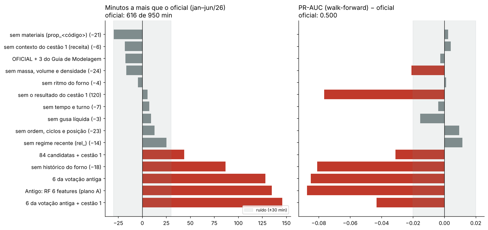

## Feature Engineering e Feature Selection — Predição de Carga Alta (EVCOMX)

Segue a aula de Feature Selection do bootcamp, o Guia de FE/FS da EVCOMX e, na revisão, o **Guia de Modelagem Preditiva da EVCOMX** (§1 a §3).

**Conjunto oficial: 121 features**, as do modelo oficial do projeto (média de 5 Gradient Boosting):
- as **84 candidatas** da engenharia de features da receita do cestão;
- **36 novas**: histórico rico do forno, gusa líquida, ritmo do forno e regime recente;
- **`carga_alta_c1`**, o resultado do cestão 1 da mesma corrida, cujo timing a EVCOMX confirmou em 31/out/2026.

Esta pasta entrega o **dataset de modelagem** desse modelo (`dataset_modelagem_fs.csv`).

> **Antes (out/2026), o conjunto final era de 6 features**, escolhidas por votação entre seis métodos (filtro, RFE, L1, Elastic Net, permutação, Boruta) para uma Random Forest: `densidade_media`, `prop_peso_pesado`, `peso_por_ciclo_t`, `taxa_ca_ult5`, `taxa_ca_ult10` e `prop_PACB`. Esse caminho foi superado quando a EVCOMX deu o critério de negócio (**menos minutos de forno perdidos**). No walk-forward, as 6 features perdem **~130 min a mais** que as 121 (744 × 616 min, com o mesmo algoritmo; seção 9).

### Como rodar

1. `src/EDA/transforma_dataset.py`: gera o `src/EDA/base.csv` limpo.
2. `src/feature_selection/feature_selection.py` (células `#%%`) ou `feature_selection_carga_alta.ipynb` (mesmo conteúdo, já executado). Leva ~15 min, por causa da seção 9.

O código acha a raiz do projeto sozinho. O protocolo comum (minutos, walk-forward, receita dos 5 HGB) vem de `comum/protocolo.py`. **Toda escolha usa só treino + validação; o teste não é aberto nesta etapa.**

### Arquivos gerados

| Arquivo | O que é |
|---|---|
| **`dataset_modelagem_fs.csv`** | **O dataset de modelagem do modelo oficial:** metadados (`cd_corrida`, `nu_carregamento`, `conjunto`, `inicio`, `t`, `t_ini`, `t_fim`, `mes`), as **121 features**, `carga_alta` e `min_parada` |
| `dataset_features_completo.csv` | Tudo o que foi calculado (140 colunas), incluindo as versões `_lag2` do histórico |
| `features_finais.json` | As listas (oficial com 121, sem o cestão 1 com 120, lag2 com 108, as 6 antigas), os 10 grupos e as 5 variantes de hiperparâmetro |
| `tabela_features_finais.csv` | **Entregável do Guia de Modelagem (§3.2)**, feature a feature: grupo, como se calcula, por que entra, quando está disponível, sinal, informação mútua e permutação |
| `grupos_features.csv` | O mesmo, por grupo, com a permutação e a ablação |
| `filtro_features.csv`, `ablacao_grupos_walkforward.csv`, `features_guia_modelagem.csv` | Filtro, tirar-um-grupo e as 3 features do Guia |
| `graficos/` | 4 figuras |

- **`conjunto`** traz o split 70/15/15 temporal (treino / validacao / teste), definido pelo professor.
- **`inicio`, `t`, `t_ini`, `t_fim` e `mes` não são features**; **`min_parada` também não**: ela só existe depois da carga alta e serve só para medir minutos perdidos.

### As 121 features em 10 grupos

| Grupo | Nº | O que é | Quando está disponível |
|---|---|---|---|
| Massa, volume e densidade | 24 | peso, volume estimado (peso ÷ densidade do material), densidade, peso/volume por classe, rendimento, energia típica, interações | após a montagem do cestão |
| Ordem, ciclos e posição | 23 | blocos e ciclos leve → pesado → misto, maior bloco, fundo/topo, 30% de baixo/cima, posição média | após a montagem |
| Materiais | 21 | proporção em peso de cada material comum, nº de materiais e baias, concentração (HHI) | após a montagem |
| Histórico do forno | 18 | taxa de carga alta nas últimas 3–50 corridas, médias exponenciais, última corrida e seus cestões, corridas desde a última carga alta, minutos parados nas últimas 10, taxa nas últimas 8 h e 24 h | quando a corrida anterior termina (`shift(1)`, nunca a atual) |
| Regime recente (`rel_`) | 14 | a feature menos a média dos 100 cestões anteriores (ou dos 60 do mesmo número de cestão) | após a montagem (usa só features passadas, nunca o alvo) |
| Tempo e turno | 7 | tempo de montagem, intervalo entre camadas, hora, turno, dia da semana | após a montagem |
| Contexto do cestão 1 (receita) | 6 | no cestão 2: volume e peso do cestão 1, volume acumulado, diferença de peso | no cestão 2; no cestão 1 vale 0 |
| Ritmo do forno | 4 | minutos desde a corrida anterior e desde o fim do cestão 2 dela; corridas nas últimas 8 h e 24 h | no início da montagem |
| Gusa líquida | 3 | toneladas de gusa líquida e de carga sólida no carregamento 3 | na programação da corrida |
| **Resultado do cestão 1** | 1 | no cestão 2, 1 se o cestão 1 da mesma corrida deu carga alta | **confirmado pela EVCOMX (31/out/2026)**; no cestão 1 vale 0 |

**Features proibidas por vazamento** (Guia §1.2): duração da parada, o alvo da própria corrida, data/hora de início como número e qualquer dado medido de energia ou fusão da corrida. A `energia_estimada_mwh` é só a energia típica de cada material vezes o peso: uma propriedade da receita.

### A decisão: tirar um grupo de cada vez, no walk-forward (§9, gráfico 03)

Mesmo protocolo da escolha do modelo: walk-forward mensal no dev, minutos de jan a jun/26 com o limiar de cada mês vindo do passado (950 min sem modelo). **Regra:** um grupo sai só se tirá-lo melhorar **além do ruído** os minutos (30 min a menos) **e** a PR-AUC (+0,02). A faixa de ruído vem das 5 variantes de hiperparâmetro, que sozinhas espalham ~575–645 min.

| Conjunto | Nº | PR-AUC WF | Min. jan–jun | Δ min | Δ PR-AUC |
|---|---|---|---|---|---|
| **OFICIAL** | **121** | **0,500** | **616** | — | — |
| sem materiais | 100 | 0,503 | 587 | −30 | +0,00 |
| sem contexto do cestão 1 | 115 | 0,504 | 598 | −18 | +0,00 |
| sem massa, volume e densidade | 97 | 0,479 | 600 | −17 | **−0,02** |
| oficial + 3 do Guia de Modelagem | 124 | 0,498 | 599 | −18 | −0,00 |
| sem ritmo do forno | 117 | 0,501 | 612 | −5 | +0,00 |
| sem o resultado do cestão 1 | 120 | 0,424 | 622 | +5 | **−0,08** |
| sem tempo e turno | 114 | 0,496 | 624 | +7 | −0,00 |
| sem gusa líquida | 118 | 0,485 | 625 | +9 | −0,02 |
| sem ordem, ciclos e posição | 98 | 0,510 | 629 | +13 | +0,01 |
| sem regime recente (`rel_`) | 107 | 0,512 | 641 | +25 | +0,01 |
| 84 candidatas + cestão 1 | 85 | 0,469 | 660 | **+44** | −0,03 |
| sem histórico do forno | 103 | 0,419 | 703 | **+87** | **−0,08** |
| 6 da votação antiga | 6 | 0,415 | 744 | **+128** | **−0,09** |
| Antigo: RF 6 features | 6 | 0,413 | 751 | **+135** | **−0,09** |

- **Nenhum grupo sai pela regra.** O mais perto é "sem materiais" (−30 min, na fronteira do ruído, PR-AUC igual): é o candidato natural a simplificar quando houver um lote novo de dados.
- **O que não pode sair:** o histórico do forno (+87 min, −0,08) e o resultado do cestão 1 (−0,08 de PR-AUC; no teste, 131 × 165 min).
- **As 36 features novas valem a pena:** só com as 84 candidatas, +44 min.
- **As 3 features do Guia de Modelagem** (violação fundo/topo, colchão no topo, volume no centro) não mudam nada além do ruído: ficam de fora, como na rodada da RF.
- **Transparência:** esta ablação já tinha sido feita na rodada 2 da otimização (31/out/2026), com a mesma conclusão ("tudo dentro do ruído"). Aqui ela é refeita de forma reproduzível.

### Respostas às perguntas do Guia (§1.3)

1. **Que informação descreve um cestão propenso a carga alta?** Antes de tudo, o **estado do forno** (carga alta nas últimas corridas); depois, pouco pesado e baixa densidade, a gusa líquida e, no cestão 2, se o cestão 1 deu carga alta (aí o cestão 2 dá **menos**: 10,6% × 19,2% no dev).
2. **O volume estimado é a feature mais importante?** **Não.** Sozinho, fica no nível do chute (correlação −0,04). O sinal está na densidade e na proporção de pesado.
3. **Ordem e ciclos agregam além de peso e volume?** **Não de forma mensurável:** tirar o grupo inteiro muda +13 min e +0,01 de PR-AUC, dentro do ruído. A informação deles já está na composição. Ficam, porque tirá-los não melhora.
4. **Que método de seleção rende melhor fora da amostra?** Para o Gradient Boosting, **não selecionar coluna a coluna**: a votação da rodada RF (6 features) perde ~130 min. O que funcionou foi engenharia de features com sentido físico + teste por grupo no walk-forward.
5. **Quantas features bastam?** Para a RF, 6 bastavam. Para o modelo oficial, os grupos que pesam são histórico, cestão 1, gusa e massa/densidade; os demais estão dentro do ruído, sem atrapalhar.

### Mudança de regime em maio/2026 (gráfico 04)

O treino vai até 25/04/2026; validação e teste caem num período em que o processo mudou: menos pesado, menos ciclos por cestão, densidade menor, com a mesma taxa de carga alta. Por isso existem as features `rel_` (a composição "para a época": o PSI delas contra o treino fica em 0,1–0,3, contra 1,0–1,5 das brutas; verificação, seção 5) e o walk-forward re-treina todo mês.

### Limitações e perguntas para a EVCOMX

- **Timing do histórico.** O histórico usa o resultado da corrida anterior. Se ele não estiver pronto na hora de prever, há a versão `_lag2` (pula uma corrida): na seleção, ela perde pouco (643 × 616 min no dev; no teste, 148 × 131).
- **`carga_alta_c1`.** Confirmado pela EVCOMX; se faltar, o app usa a reserva (as 120 features sem ele).
- **Muitas features correlacionadas.** Não atrapalham o desempenho, mas dividem a importância entre as cópias. Leia a importância por grupo.
- **Corte de 2.000 kg.** A verificação refaz as features com cortes de 0, 100, 1.000 e 2.000 kg e re-treina o oficial: a PR-AUC no teste varia de 0,57 a 0,58.
- **scikit-learn 1.9.1.** Com outra versão, os números podem mudar um pouco.
